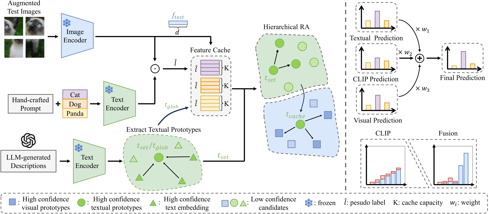

# Beyond Unimodal Reliance: Multimodal Synergy for Training-Free Test-Time Adaptation

**MMS-TTA** — Code for *Beyond Unimodal Reliance: Multimodal Synergy for Training-Free Test-Time Adaptation*.

Paper link and publication details will be added when available.

Guohao Jiang, Chenhao Ding, SongLin Dong, Zhiheng Ma, Qiang Wang, Yuhang He, and Yihong Gong

> **Abstract:**  Test-Time Adaptation (TTA), particularly the training-free paradigm, has garnered widespread attention due to its significant advantages in addressing test-time distribution shifts in Vision-Language Models. However, existing training-free approaches are often constrained by the inherent limitations caused by an over-reliance on a single textual or visual modality, resulting in suboptimal performance and robustness. To address this issue, we propose a novel **training-free dynamic multimodal synergy strategy**. First, to extract textual modality features with enhanced robustness, we construct a cache-based, hierarchical retrieval-augmented TTA paradigm. Building upon this, we introduce a negative-entropy-driven dynamic synergy mechanism that adaptively fuses the optimized textual modality, the visual modality, and the original CLIP modality. This integration ultimately yields a predictive distribution characterized by both high robustness and high confidence. Our approach significantly enhances class discriminability while maintaining exceptional robustness during testing. Extensive experiments across multiple benchmarks demonstrate that the proposed method consistently outperforms state-of-the-art approaches in both performance and efficiency.

<p align="center">
    
</p>

## <a name="installation"></a> Installation

The environment configuration for this codebase is as follows. It may work with other versions.

- Python 3.9.23
- CUDA 11.8
- PyTorch 2.2.0 + cu118

For Linux x86-64 systems with Conda installed, run the following script to set up the environment required by MMS-TTA:

```bash
bash scripts/install.sh
conda activate mmstta
```

To use another environment name, run `bash scripts/install.sh <env_name>` and activate that environment instead.

## Datasets

Follow [Datasets](docs/DATASETS.md) to prepare the datasets.

Dataset identifiers for `--datasets`:

- ImageNet benchmarks: `A` (ImageNet-A), `V` (ImageNetV2), `R` (ImageNet-R), `S` (ImageNet-Sketch).
- Cross-domain benchmarks: `caltech101`, `oxford_pets`, `stanford_cars`, `oxford_flowers`, `food101`, `fgvc`, `sun397`, `dtd`, `ucf101`.

## <a name="training"></a> Running

Run commands from the project root. Extract features first, then select the evaluation script for your dataset.

### 1. Extract features

Edit the arguments in `scripts/extract.sh`:

- `--data-root`: dataset root; replace `/path/to/datasets` with your actual path.
- `--datasets`: dataset identifier, such as `A` or `dtd`; use `A/V/R/S` to extract multiple datasets sequentially.
- `--save_path`: feature output directory, default `./features/vit_b16`.
- `--backbone`, `--views`: backbone and view count, default `ViT-B/16` and `64`.

After updating the arguments, run the following script to extract features for the selected datasets:

```bash
bash scripts/extract.sh 0
```

`0` selects the GPU. Features are saved as `<save_path>/<dataset>.pth`.

### 2. Run evaluation

For ImageNet-A, edit the arguments in `scripts/run_ood.sh`:

- `--datasets`: set to `A`; enable only one dataset per evaluation.
- `--features-root`: feature directory, matching the extraction `--save_path`.
- `--backbone`, `--views`: keep consistent with feature extraction.

After updating the arguments, run the following script to evaluate the selected dataset:

```bash
bash scripts/run_ood.sh 0 demo_ood
```

Similarly, for cross-domain datasets, set the corresponding arguments in `scripts/run_cross.sh`, then run the following script to evaluate the selected dataset:

```bash
bash scripts/run_cross.sh 0 demo_cross
```

The first argument selects the GPU; the second names the experiment (without spaces). Set the dataset inside the script, not as a command-line argument. Results are saved to `log/eval/<dataset>/<experiment>.txt`; if the experiment name contains `search`, they are saved to `log/search/<dataset>/<experiment>.txt` instead. If the log already exists, choose a new experiment name; otherwise the runner skips it. All three scripts delete existing `log/eval/*/debug.txt` files before running.

## <a name="cite"></a> Citation

The formal BibTeX citation will be added once publication details are available. For now, please refer to the title and author list above.

## License

This project is released under the [MIT license](LICENSE).

## Acknowledgement

This code is based on [RA-TTA](https://github.com/kaist-dmlab/RA-TTA) and [BoostAdapter](https://github.com/taolinzhang/BoostAdapter), and includes code from [CLIP](https://github.com/openai/CLIP). We thank the authors for making their work available.
